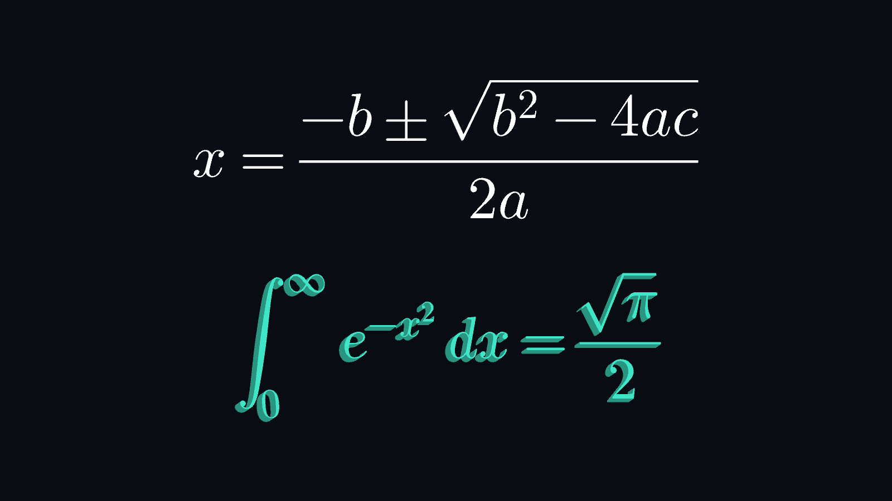

# MathMesher

作者: kinankomoti

TeX / LaTeX の数式から、文字の輪郭に沿った平面 Mesh と、厚み付き Mesh を Unity Editor で生成する UPM パッケージです。TeX の組版規則に沿った数式エンジンと数式フォントを同梱しており、外部 TeX ソフト、TextMeshPro、VRChat SDK の追加導入は不要です。



## インストール

Unity **2022.3 以降**を対象としています。検証環境は 2022.3.22f1、Built-in Render Pipeline、Windows Editor です。

このプロジェクトでは `Packages/com.kinankomoti.mathmesher` に配置済みです。別のプロジェクトでは、このフォルダー全体をコピーし、Package Manager の **Add package from disk...** から `package.json` を選択してください。配布用 `.tgz` は **Add package from tarball...** で導入できます。

## 使い方

1. **GameObject → MathMesher → Math mesh** でオブジェクトを作成します。
2. Inspector の **Formula** に数式を入力します。**Auto update** がオンなら入力のたびに Mesh がすぐ更新されます。オフのときは **Update** で更新します。
3. `Mode` を `Flat` / `Extruded` に切り替えます。`Depth` は `Extruded` のとき、`Double sided` は `Flat` のときだけ表示されます。
4. **Save mesh...** で `.asset` を保存します。同じ Mesh アセットに再保存すると GUID と参照を維持します。

`MathMesh` を付けたシーンを Player ビルドする場合は、ビルド時に現在の入力から Mesh を作り直し、ビルド用のシーンから編集コンポーネントを取り除きます。不正な数式はビルドエラーになります。数式エンジンは Editor 専用で Player に含まれません。

数式にエラーがある場合は、Inspector に理由と位置を表示し、最後に正常に生成した Mesh を保持します。空の入力では表示を消します。

## リアルタイム更新とキャッシュ

入力中にプレビューが追従するよう、生成の各段階をキャッシュしています。

| 段階 | 再利用されるもの |
| --- | --- |
| 文字の三角形分割 | フォント・グリフ・曲線精度ごとに 1 回だけ輪郭を分割し、以降は再利用します。 |
| 配置単位の頂点 | 同じグリフ・同じ大きさ・同じ厚みの部品は、面と側面の頂点ごと再利用します。 |
| 数式全体 | 直近 48 件の数式と設定の組み合わせは、結果をそのまま返します（Undo / Redo など）。 |
| プレビュー Mesh | 編集のたびに Mesh を作り直さず、同じ Mesh オブジェクトの中身だけを差し替えます。入力と設定が変わらなければ再生成しません。 |

そのため、入力を変更したときに新しく計算されるのは、変更で初めて現れた文字の輪郭だけです。開発環境での計測では、最初の生成（フォント読み込みを含む）が約 0.2 秒、その後の 1 文字単位の編集は 1 ms 前後でした。Inspector には頂点数と生成時間を表示します。キャッシュは Editor のセッション中だけ保持し、`MathMeshGenerator.ClearCache()` で破棄できます。

## 設定

| 設定 | 内容 |
| --- | --- |
| Mode | 平面、または押し出しによる立体 |
| Math style | Display / Inline。総和・積分や上下付き文字の配置に影響 |
| Alignment | Baseline left / Bottom left / Center / Top left |
| Font size | 文字の大きさ（1 em）を Unity 単位で指定。小文字の高さはおよそその半分（API 上の名前は `emSize`） |
| Depth | 立体の厚み。Unity 単位。`Extruded` のときだけ表示 |
| Curve tolerance | 曲線の近似誤差。em 単位。小さいほど滑らかで頂点数が増える |
| Double sided | 平面の裏面も生成する。`Flat` のときだけ表示（立体には常に表裏と側面がある） |
| Color | 頂点カラー。数式内の色と乗算される |
| Fallback fonts | 同梱フォントにない文字（日本語など）に使う `.ttf` / `.otf`。上から順に探す |

Inspector の表示は英語です。数式の構文エラーなど、生成時のエラーメッセージは日本語です。

既定マテリアルは頂点カラーを表示し、側面を少し暗くするシェーダーです。シーンの照明には依存しません。別のマテリアルにも変更できますが、頂点カラーを読まないシェーダーでは `Color` や数式内の色は反映されません。

`\colorbox` などの背景は、文字の少し奥（+Z 側）に配置し、同一平面での重なり（Z ファイティング）を避けています。

## 数式記法

TeX / LaTeX の数式記法、amsmath・amssymb・mathtools と、よく使われる数式パッケージの記法に対応しています。`Tests/Editor` と `Tools~` の検証コーパスで、以下の全分類を生成・描画して確認しています。

| 分類 | 主な命令 |
| --- | --- |
| 上下付き・プライム | `x^2_1`, `f'`, `f''`, `{}^{14}_{6}C`, `x²`（Unicode の上付き・下付き文字も可） |
| 分数・二項係数 | `\frac`, `\dfrac`, `\tfrac`, `\cfrac[l]`, `\genfrac`, `\binom`, `\dbinom`, `\tbinom`, `\over`, `\atop`, `\choose`, `\brack`, `\brace`, `\above`, `\abovewithdelims` など, `\sfrac`, `\nicefrac` |
| 根号 | `\sqrt{x}`, `\sqrt[3]{x}`, `\root 3 \of x` |
| 大型演算子 | `\sum`, `\prod`, `\coprod`, `\int`〜`\iiiint`, `\oint`, `\oiint`, `\oiiint`, `\idotsint`, `\bigcup` などの `\big...` 演算子, `\limits`, `\nolimits`, `\substack`, `\sideset`, `\prescript` |
| 関数名 | `\sin`〜`\tanh`, `\log`, `\lim`, `\limsup`, `\varlimsup`, `\varinjlim`, `\argmax`, `\operatorname`, `\operatorname*`, `\mathop` |
| 括弧 | `\left`, `\middle`, `\right`, `\big`〜`\Bigg`（`l` / `r` / `m` 付き）, `\langle`, `\lfloor`, `\lceil`, `\lVert`, `\llbracket`, `\lgroup`, `\lmoustache`, 矢印の伸縮括弧 |
| アクセント | `\hat`, `\check`, `\tilde`, `\acute`, `\grave`, `\dot`, `\ddot`, `\dddot`, `\breve`, `\bar`, `\vec`, `\mathring`, `\widehat`, `\widetilde`, `\widecheck`, `\utilde` |
| 線・括弧類 | `\overline`, `\underline`, `\overbrace{}^{}`, `\underbrace{}_{}`, `\overbracket`, `\underbracket`, `\overparen`, `\underparen`, `\overgroup`, `\undergroup` |
| 矢印付き | `\overrightarrow`, `\overleftarrow`, `\overleftrightarrow`, `\Overrightarrow`, `\underrightarrow` など, `\xrightarrow[下]{上}` ほか `\xleftarrow`, `\xRightarrow`, `\xLeftrightarrow`, `\xmapsto`, `\xhookrightarrow`, `\xrightleftharpoons`, `\xlongequal` など |
| 積み重ね | `\overset`, `\underset`, `\stackrel`, `\overunderset` |
| 環境 | `matrix`, `pmatrix`, `bmatrix`, `Bmatrix`, `vmatrix`, `Vmatrix`（`*` 付きの列揃え指定も可）, `smallmatrix` 系, `array`（`l c r p{}`, `|`, `:`, `@{}`, `*{n}{}`, `\hline`, `\hdashline`, `\cline`, `\multicolumn`）, `subarray`, `cases`, `cases*`, `dcases`, `rcases`, `aligned`, `alignedat`, `gathered`, `split`, `align`, `alignat`, `flalign`, `gather`, `multline`（`\shoveleft` / `\shoveright`）, `eqnarray`, `equation`, `CD`（可換図式）, `\displaylines`, `\hdotsfor`, `\intertext` |
| 番号 | `\tag{}`, `\tag*{}`, `\notag`, `\nonumber`（自動の式番号は付けません） |
| 数式フォント | `\mathrm`, `\mathit`, `\mathbf`, `\mathsf`, `\mathtt`, `\mathcal`, `\mathscr`, `\mathfrak`, `\mathbb`, `\mathbfit`, `\mathsfit` など, `\boldsymbol`, `\bm`, `\pmb`, `\rm` などの宣言形 |
| テキスト | `\text`, `\textrm`, `\textit`, `\textbf`, `\textsf`, `\texttt`, `\textsc`, `\emph`, `\mbox`, テキスト中の `$...$` と `\(...\)`, `\'e` などのアクセント, `--` `---` などの合字 |
| 色 | `\color`, `\textcolor`, `\colorbox`, `\fcolorbox`, `\definecolor`, 色モデル `rgb` `RGB` `HTML` `gray` `cmyk` `hsb`, xcolor の名前と `red!50!blue` 形式, dvipsnames, CSS の色名 |
| 囲み・取り消し線 | `\boxed`, `\fbox`, `\cancel`, `\bcancel`, `\xcancel`, `\cancelto`, `\sout`, `\angl`, `\phase`, `\enclose{circle box ...}`, `\bbox` |
| 空白・配置 | `\,` `\:` `\;` `\!` `\quad` `\qquad` `\enspace` `\ ` `~`, `\hspace`, `\kern`, `\mkern`, `\mskip`, `\phantom`, `\hphantom`, `\vphantom`, `\smash`, `\mathstrut`, `\llap`, `\rlap`, `\mathclap` など, `\raisebox`, `\rule`, `\vcenter` |
| スタイル・大きさ | `\displaystyle`〜`\scriptscriptstyle`, `\tiny`〜`\Huge`, `\mathchoice` |
| 原子の分類 | `\mathord`, `\mathbin`, `\mathrel`, `\mathopen`, `\mathclose`, `\mathpunct`, `\mathinner` |
| 記号 | LaTeX と AMS の記号表の関係・演算子・矢印・ギリシャ文字（`\varGamma`, `\upalpha` など）・ヘブライ文字・その他記号, `\not`, `\pmod`, `\bmod`, `\iff`, `\implies`, `\coloneqq`, `\bra` `\ket` `\braket` `\Set` |
| unicode-math の記号名 | unicode-math パッケージの記号名 2447 個すべて（`\wedgedot`, `\veedot`, `\lbag`, `\llangle`, `\Bbbsum`, `\fullouterjoin`, `\QED`, `\mupalpha`, `\mbfscrB`, `\candra` など）。上の表と同じ名前の場合は従来の LaTeX / AMS の定義を優先します |
| その他 | `\TeX`, `\LaTeX`, `\char"263A`, `\unicode{x2603}`, `\verb|...|`, `%` コメント, 数式中に直接入力した Unicode 記号 |

数式本体のほか、外側の `$...$`、`$$...$$`、`\(...\)`、`\[...\]` も受け付けます。式の外側に `&` や `\\` を書いた場合は、`aligned` / `gathered` として複数行に組みます。

### 制限

- 文書機能、ユーザー定義マクロ（`\newcommand`、`\def` など）、`\usepackage` とファイル読み込みは対象外です（初期仕様どおり）。
- 化学式（mhchem の `\ce`）、単位（siunitx）、physics パッケージ、TikZ などの図、`\label` / `\ref` による参照は未対応です。
- 自動の式番号は付けません。番号が必要な場合は `\tag` を使ってください。
- 1 行に収まらない式の自動改行はしません。
- 同梱フォントは Latin Modern Math、STIX Two Math、AMS 黒板太字、キリル文字です。日本語など、これらにない文字は Fallback Fonts に `.ttf` / `.otf` を指定してください。指定がない場合はエラーとして文字を表示します。
- 上下付き文字は縮小表示で、フォントの光学サイズ用の字形（ssty）とグリフごとの切り込みカーニングは使っていません。
- 立体化は押し出しです。ベベル、Collider は含みません。文字どうしや背景と重なる部分は合成しないため、3D プリント用の単一の閉じた立体としては保証しません。
- 入力は 16384 文字以内、Mesh は 100 万頂点以内です。
- URP / HDRP、macOS / Linux Editor での動作は未検証です。

## Editor API

```csharp
using MathMesher;
using MathMesher.Editor;
using UnityEngine;
using UnityEditor;

var result = MathMeshGenerator.Generate(
    @"\frac{\sqrt{x}}{2}",
    new MathMeshSettings { mode = MathMeshMode.Extruded, depth = 0.15f });
var go = new GameObject("Math", typeof(MeshFilter), typeof(MeshRenderer));
go.GetComponent<MeshFilter>().sharedMesh = result.Mesh;
go.GetComponent<MeshRenderer>().sharedMaterial = AssetDatabase.LoadAssetAtPath<Material>(
    "Packages/com.kinankomoti.mathmesher/Runtime/Materials/MathMesher.mat");
```

上記 API は Editor 用です。生成した Mesh の所有権は呼び出し側にあり、保存するか、不要になった時に `DestroyImmediate` で破棄してください。既存の Mesh に書き込む `MathMeshGenerator.GenerateInto(mesh, latex, settings)` もあります。`MathMeshResult` には組版上の幅・高さ・深さ、生成時間、キャッシュから返したかどうかを保持します。Unity のメインスレッドから呼び出してください。不正な数式では `ArgumentException` を投げます。

`MathMeshAuthoring.BakeToAsset(component, "Assets/Math.asset")` も利用できます。

0.3.0 でパッケージ名を TeXmexsh から MathMesher に変更しました。パッケージ ID は `com.kinankomoti.mathmesher`、名前空間は `MathMesher` / `MathMesher.Editor`、主なクラスは `MathMesh`、`MathMeshSettings`、`MathMeshGenerator`、`MathMeshAuthoring` です。0.3.1 で同梱 DLL も `MathMesher.Fonts.dll` に作り直しました（中身はフォント読み込み部分と数式フォントのみ）。

## 仕組み

`Editor/Engine` に、パッケージ独自の TeX 数式エンジンがあります。

1. **Parser** — TeX のトークン規則（制御語の後の空白、1 トークン引数、中置の `\over`、環境、テキストモード）に従って構文木を作ります。
2. **Typesetter** — TeX の数式組版規則（Appendix G）を OpenType MATH テーブルの定数で実装しています。原子の分類と間隔、上下付き、分数、根号、極限、伸縮する括弧・矢印・アクセント（フォントの字形バリアントと部品の組み立て）、表を組みます。
3. **Geometry** — 配置済みのグリフ・罫線・図形を、キャッシュした三角形分割から Mesh の頂点に変換します。

フォントの読み込みには同梱 DLL の Typography、三角形分割には LibTessDotNet を使っています。

## サンプルと検証

Package Manager の Samples から **Examples** を Import すると、平面の二次方程式と立体の積分式の Prefab・Mesh・シーンを利用できます。

`Tests/Editor` に数式記法、文字の穴、立体の法線、曲線精度、入力エラー、キャッシュ、プレビュー Mesh の再利用、背景の奥行き、保存時の GUID、ビルド前処理のテストがあります。Test Runner に表示するにはプロジェクトの `Packages/manifest.json` の `testables` に `com.kinankomoti.mathmesher` を追加してください。

## 同梱ライブラリ

Typography、LibTessDotNet と数式フォントを使用しています。出典、固定コミット、変更内容、ライセンスは `ThirdPartyNotices.md` と `Third Party Notices` を参照してください。
